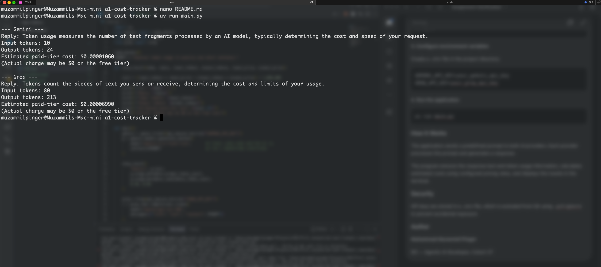

# Two Provider Cost Tracker

**IEC Agentic AI Developer — Assignment 1**

## About the Project

For my first assignment, I built a simple Python program that connects to two AI providers: Google Gemini and Groq.

The idea is to send the same question to both models and see how they respond. The program also shows how many tokens each model uses and estimates the cost of each request.


## Tools Used

- Python
- uv
- Google Gemini API
- Groq API
- python-dotenv

## How to Run

First, clone the repository and install the required packages:

```bash
git clone https://github.com/YOUR_USERNAME/a1-cost-tracker.git
cd a1-cost-tracker
uv sync
```

Create a `.env` file in the project folder and add your API keys:

```env
GEMINI_API_KEY=your_key
GROQ_API_KEY=your_key
```

Run the program:

```bash
uv run main.py
```

## What I Learned

While working on this assignment, I learned how to connect Python to AI APIs, send prompts, retrieve responses, and calculate token-based costs.

I also learned why API keys should be stored in environment variables instead of directly in the code.

## Sample Output

The screenshot below shows a successful run of the program with responses from both providers.



## Author

Muhammad Muzammil Pinger

IEC Agentic AI Developer — Cohort 37
