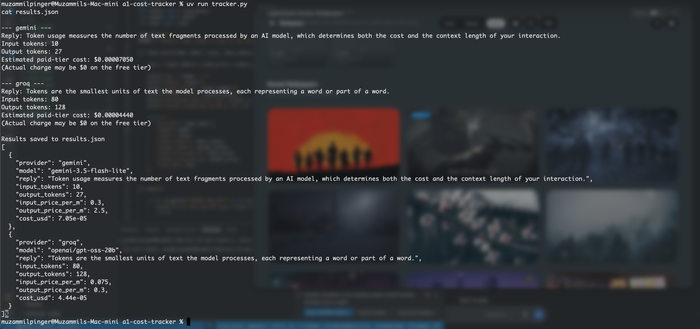
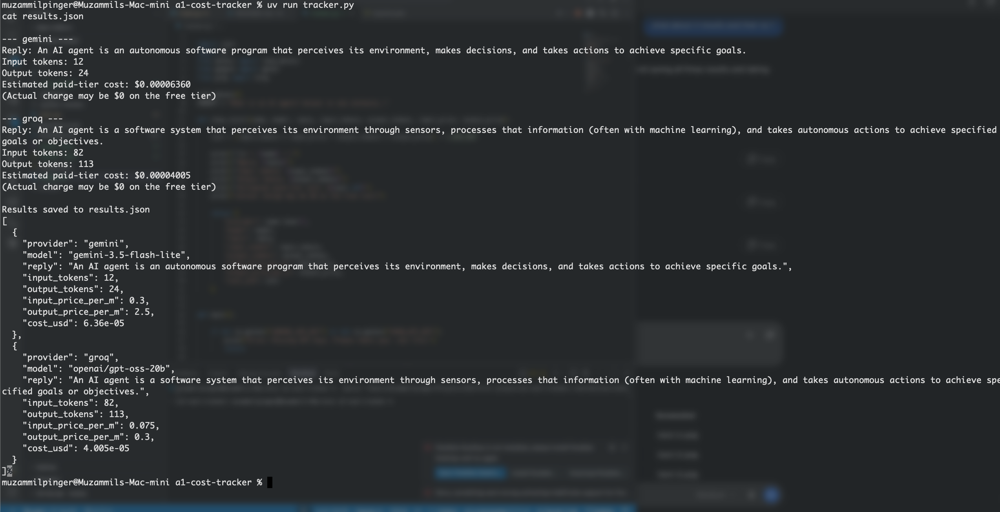
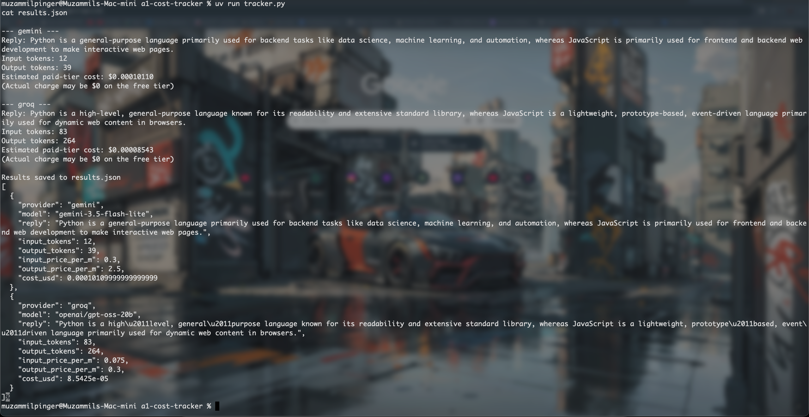

# Two Provider Cost Tracker

**IEC Agentic AI Developer — Assignment 1**

## About the Project

For my first assignment, I built a simple Python program that connects to two AI providers: Google Gemini and Groq.

The idea is to send the same question to both models and see how they respond. The program also shows how many tokens each model uses and estimates the cost of each request.

I tested the program using three different prompts to see how the responses and token counts change.

## Tools Used

- Python
- uv
- Google Gemini API
- Groq API
- python-dotenv
- Git & GitHub

## How to Run

First, clone the repository and install the required packages:

```bash
git clone https://github.com/Muzammilpinger/IEC---first-assigment.git
cd IEC---first-assigment
uv sync
```

Create a `.env` file in the project folder and add your API keys:

```env
GEMINI_API_KEY=your_key
GROQ_API_KEY=your_key
```

Run the program:

```bash
uv run tracker.py
```

The program will display both AI responses, input and output token counts, and estimated costs. It will also save the results in `results.json`.

## Testing

I ran the program with three different prompts to compare how Gemini and Groq respond.

Each test was run using the same prompt for both providers.

### Test 1 — Token Usage

**Prompt:** Explain token usage in exactly one short sentence.



[View JSON Results](results-1.json)

### Test 2 — AI Agents

**Prompt:** What is an AI agent? Answer in one sentence.



[View JSON Results](results-2.json)

### Test 3 — Python and JavaScript

**Prompt:** Explain the difference between Python and JavaScript in one sentence.



[View JSON Results](results-3.json)

## What I Learned

While working on this assignment, I learned how to connect Python to different AI APIs, send prompts, and retrieve responses.

I also learned how input and output tokens are counted, how API costs are calculated, and why different AI providers can use different numbers of tokens for the same prompt.

Another important thing I learned was how to keep API keys secure using `.env` and `.gitignore` instead of including them directly in the code.

## Security

API keys are stored in a local `.env` file and are not uploaded to GitHub. The `.env.example` file provides placeholders for setting up the project.

## Author

**Muhammad Muzammil Pinger**

IEC Agentic AI Developer — Cohort 37